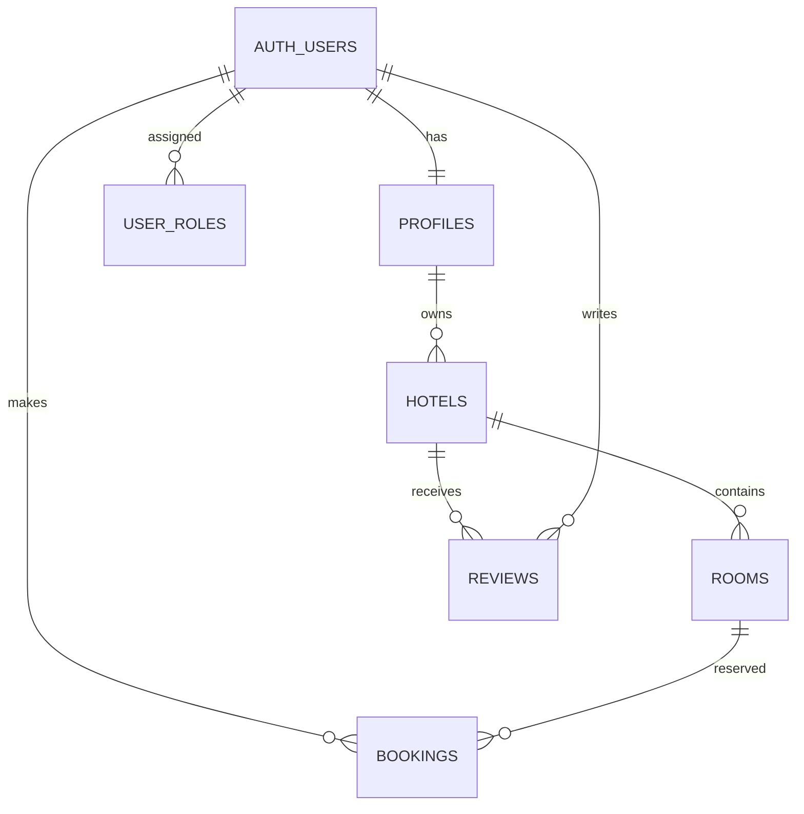

# Stayfinder

Stayfinder is a responsive hotel discovery and booking app. Guests can browse independent stays, filter by destination, save favorites, make reservations, and see their trips. Administrators can upload property cover photos and manage listings.

The app is built with HTML, CSS, vanilla JavaScript, Bootstrap, Vite, and Supabase. Without Supabase credentials it runs in demo mode with sample stays and browser-local reservations. Authentication, database-backed reservations, admin tools, and uploads become active after connecting a Supabase project.

## Screens

- `index.html` — discovery homepage and search
- `stays.html` — searchable, filterable collection
- `property.html` — stay details, amenities, and room selection
- `booking.html` — reservation form and price summary
- `trips.html` — guest reservations
- `saved.html` — stays saved in this browser
- `login.html` — sign in and account creation
- `admin.html` — role-protected listing and image upload tools

## Architecture

Each HTML file is a Vite multi-page entry. Shared browser code lives in `src/js/`; Supabase access is isolated in `src/js/supabase.js`, sample properties in `src/js/data.js`, and shared responsive styles in `src/app.css`. The browser communicates with Supabase through `@supabase/supabase-js` and its REST/Auth/Storage APIs. There is no custom server or client-side framework.

## Database design

The initial schema is in `supabase/migrations/202611080001_initial_schema.sql`.



RLS restricts profile, role, and booking access. Hotel reads are public only for published listings. Admin-only policies manage listings, rooms, roles, and the public `hotel-images` Storage bucket. Database triggers calculate booking totals from the room rate, and an exclusion constraint prevents overlapping active reservations for the same room.

## Local setup

Requirements: Node.js 20.19+ or 22.12+, npm. Docker Desktop is required only for the local Supabase stack.

```sh
npm install
npm run dev
```

Open the local URL printed by Vite. Demo stays and local-only bookings work without Supabase.

To start the local Supabase backend, keep Docker Desktop running and use a second terminal:

```sh
npx supabase start
npx supabase db reset
```

The reset applies migrations and seeds three sample hotels with rooms. Copy the local API URL and anon/publishable key shown by `supabase start` into `.env.local` as `VITE_SUPABASE_URL` and `VITE_SUPABASE_ANON_KEY`, then restart Vite. Never use a service-role key in browser code.

To connect a hosted Supabase project:

1. Create a Supabase project and copy its project URL and anon/publishable key into `.env.local`.
2. Authenticate the CLI with `npx supabase login`, then link with `npx supabase link --project-ref <project-ref>`.
3. If the hosted database already contains schema changes, sync its history first with `npx supabase db pull`. For a new project, apply this repository's migration with `npx supabase db push`.
4. Create a user through the app or Supabase Auth, then promote the trusted account in the SQL editor:

```sql
insert into public.user_roles (user_id, role)
select id, 'admin' from auth.users where email = 'admin@example.com'
on conflict do nothing;
```

The admin form uploads a property image and first room before publishing. The browser only needs the public anon/publishable key; never put the service-role key in `.env.local` or Netlify frontend variables.

Run `npm run build` to validate all page entries and create the static deployment bundle in `dist/`.
Run `npm test` for the booking date and total calculation unit tests.

## Key files

- `vite.config.js` — registers each HTML page as a production entry
- `src/js/main.js` — shared rendering and page interactions
- `src/js/data.js` — clearly separated demo properties
- `src/js/supabase.js` — Supabase client, Auth, booking, and listing services
- `src/app.css` — shared responsive design system
- `supabase/migrations/` — versioned database schema and policies
- `supabase/seed.sql` — repeatable sample hotel/room records for local resets
- `supabase/config.toml` — local Supabase services, Auth URLs, and Storage bucket
- `.github/copilot-instructions.md` — project-wide coding and security guidance
- `.env.example` — required public Supabase configuration names

## Deployment and demo access

The live site is [stayfinder-aleksandarstoykov97.netlify.app](https://stayfinder-aleksandarstoykov97.netlify.app/). The repository includes `netlify.toml` with the Vite build command and `dist/` publish directory. To deploy from a local machine, install the Netlify CLI, authenticate with `netlify login`, link or create a site with `netlify init`, then run `netlify deploy --prod`. Alternatively, connect this GitHub repository in the Netlify dashboard; Netlify will read the build settings from `netlify.toml`.

Set the two `VITE_SUPABASE_*` variables in Netlify's environment settings and apply the database migration before enabling live accounts. Without those settings, the published frontend runs in demo mode. No sample account is included because a real Supabase user must be provisioned.